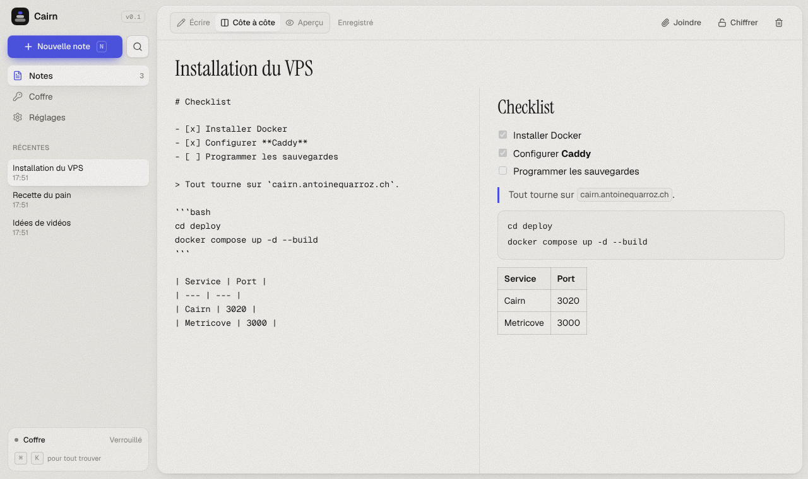

# Cairn

Mes notes et mes secrets, chez moi. Un Notion sur mesure, auto-hébergé sur mon VPS : tout s'écrit en Markdown, avec un coffre chiffré pour les mots de passe et les clés SSH.

Cairn fait partie de la même suite que [Metricove](https://github.com/antoinequarroz/metricove_v2) (réseaux sociaux) et [Alfred](https://github.com/antoinequarroz/Alfred) (calendrier) : même stack, même design, une autre couleur.

En ligne sur **https://cairn.antoinequarroz.ch** (voir [docs/DEPLOIEMENT.md](docs/DEPLOIEMENT.md)).



## Ce qui marche aujourd'hui

- **Notes en Markdown** : écriture, aperçu ou les deux côte à côte, enregistrement automatique, recherche ⌘K.
- **Images, vidéos, sons, fichiers** : glisse-les ou colle-les dans une note. Les vidéos se lisent dans la page.
- **Coffre** : identifiants, clés SSH et accès VPS, notes secrètes, générateur de mots de passe. Chiffré sur l'appareil, le serveur ne voit jamais le contenu.
- **Cadenas par note** : une note sensible peut être chiffrée de bout en bout avec la clé du coffre.
- **Accès protégé** par mot de passe, modifiable dans Réglages.
- **Installable** comme une app sur Mac (Safari, « Ajouter au Dock ») et sur iPhone (« Sur l'écran d'accueil »).
- **API** pour Hermes et Claude Code, qui peuvent lire et écrire des notes.

La suite (IA, dossiers, apps Mac et iOS natives) est dans [docs/ROADMAP.md](docs/ROADMAP.md).

## Lancer en local

```bash
pnpm install
pnpm dev
```

Puis ouvrir http://localhost:3000. Sans `APP_PASSWORD`, l'app est ouverte en local (et refuse de démarrer en production).

```bash
pnpm test    # tests du chiffrement
pnpm lint
pnpm build
```

## Configuration

Copier `.env.example` en `.env.local` (en local) ou `.env` (sur le VPS) :

| Variable | Rôle |
| --- | --- |
| `APP_PASSWORD` | Mot de passe de l'app. **Obligatoire en ligne.** Il se change ensuite dans **Réglages** : le nouveau est gardé (haché) dans `data/auth.json` et passe devant `APP_PASSWORD`. Mot de passe oublié : supprime ce fichier, `APP_PASSWORD` revient. |
| `API_TOKEN` | Jeton pour Hermes et Claude Code (`Authorization: Bearer …` sur `/api`). N'ouvre jamais le coffre. |
| `DATA_DIR` | Dossier de la base SQLite et des fichiers joints (`./data` par défaut). |
| `MAX_FILE_MB` | Taille maximale d'un fichier joint (500 Mo par défaut). |

Le **mot de passe maître du coffre** n'est pas une variable : il se choisit dans l'app, n'est jamais envoyé au serveur, et ne peut pas être récupéré s'il est perdu.

## API (pour Hermes et Claude Code)

| Méthode | Route | Rôle |
| --- | --- | --- |
| GET | `/api/notes` | Lister les notes (titre, extrait, date) |
| POST | `/api/notes` | Créer une note (`title`, `content` en Markdown) |
| GET | `/api/notes/:id` | Lire une note |
| PATCH | `/api/notes/:id` | Modifier une note |
| DELETE | `/api/notes/:id` | Supprimer une note |
| POST | `/api/files` | Commencer l'envoi d'un fichier (`name`, `mime`, `size`) |
| PUT | `/api/uploads/:id?offset=N` | Envoyer un morceau du fichier (8 Mo au plus) |
| GET | `/api/files/:id` | Télécharger un fichier |

```bash
curl -H "Authorization: Bearer $API_TOKEN" -H "Content-Type: application/json" \
  -d '{"title":"Idée","content":"# Une idée\n\nÀ creuser."}' \
  https://cairn.antoinequarroz.ch/api/notes
```

Les notes chiffrées de bout en bout sont renvoyées chiffrées : un script ne peut pas les lire.

## Documentation

- [Architecture](docs/ARCHITECTURE.md) : comment c'est construit, et pourquoi
- [Sécurité](docs/SECURITE.md) : ce qui est chiffré, contre quoi, et les limites
- [Déploiement](docs/DEPLOIEMENT.md) : mise en ligne sur le VPS, sauvegardes
- [Roadmap](docs/ROADMAP.md) : les prochaines étapes

## Stack

Next.js 15, SQLite (better-sqlite3), Tailwind CSS 4, cmdk, Sonner, marked + DOMPurify, Web Crypto + Argon2id (hash-wasm). La même base que Metricove.
