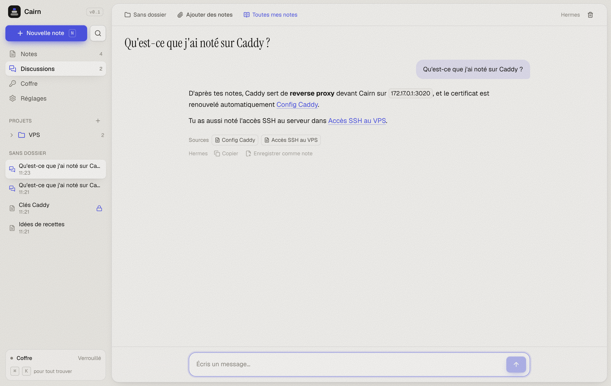

# L'IA dans Cairn

## Ce que fait le bouton « IA »

Dans une note, le bouton **IA** (à côté de « Joindre ») propose :

| Action | Ce qu'elle fait |
| --- | --- |
| Résumer | Les points clés, sans rien inventer |
| Améliorer la rédaction | Plus clair et plus fluide, même sens, même ton |
| Corriger l'orthographe | Orthographe, grammaire, ponctuation, et rien d'autre |
| Continuer d'écrire | La suite du texte, à partir du curseur |
| Traduire | En français, anglais, allemand, italien ou espagnol |
| Consigne libre | Ce que tu écris : « fais-en une liste de tâches », « écris un plan pour… » |

L'action porte sur **le texte sélectionné**, ou sur **toute la note** si rien n'est sélectionné. « Continuer » prend toujours le texte avant le curseur.

La réponse ne va pas directement dans la note. Elle s'écrit dans un panneau sous la note, au fil de l'eau (**Arrêter** la coupe), puis tu choisis :

- **Remplacer la sélection** (ou **Remplacer la note** : pendant quelques secondes, la notification propose **Annuler** pour retrouver l'ancien texte),
- **Insérer en dessous** (pour « Continuer » : **Insérer à la suite**),
- **Copier**,
- **Fermer**, et rien ne change.

Si tu as modifié la note pendant que l'IA écrivait, Cairn retrouve le passage d'origine. S'il n'existe plus, il te le dit plutôt que d'écraser autre chose.

## Les discussions

À côté du bouton, Cairn garde de vraies **discussions** avec l'IA, rangées comme des notes :

- **Projets et dossiers.** Un projet est un dossier à la racine de la barre latérale. Il contient des notes, des discussions et des sous-dossiers. On y range n'importe quoi en le glissant sur un dossier, ou avec le sélecteur de dossier en haut d'une note ou d'une discussion. Supprimer un dossier ne supprime rien d'autre : son contenu remonte d'un niveau.
- **Consignes du projet.** La page d'un dossier a un champ « Consignes pour l'IA » (« ce projet parle de mon VPS Debian, réponds avec les commandes à taper »). Elles sont lues au début de chaque discussion du dossier et de ses sous-dossiers, celles du projet d'abord, celles du dossier le plus proche en dernier.
- **Notes en contexte.** « Ajouter des notes » épingle des notes à la discussion : l'IA les relit avec chaque message (20 notes et 200 000 caractères au plus ; au-delà, Cairn dit lesquelles n'ont pas été lues). Depuis une note, **Discuter** ouvre une discussion avec cette note déjà épinglée.
- **Rien ne se perd.** La réponse est écrite par le serveur, qui l'enregistre au fil de l'eau. Tu peux fermer l'onglet ou passer à autre chose : la réponse continue et t'attend dans la discussion. **Arrêter** la coupe et garde ce qui est déjà écrit.
- **Enregistrer comme note** transforme une réponse en note, dans le même dossier que la discussion.
- Le titre vient du premier message. Il se change en cliquant dessus.

Une discussion envoie à chaque message tout son historique (les plus anciens messages sont laissés de côté au-delà de 300 000 caractères). Avec Claude, le début de la conversation est mis en cache chez Anthropic : les messages suivants le relisent pour un dixième du prix.

## Brancher une IA

Le plus simple : **Réglages > Intelligence artificielle**, dans l'app. Tu y entres une clé d'API ou l'adresse de Hermes, tu choisis le fournisseur et le modèle, et le bouton **Tester** vérifie que ça répond (avec une phrase fixe : aucune note n'est envoyée). Les clés y sont gardées chiffrées sur le serveur et ne reviennent jamais dans le navigateur.

Ce qui est saisi dans Réglages passe avant le `.env`. Un champ laissé vide prend la valeur du `.env`, qui reste un repli valable : les trois façons ci-dessous s'y règlent aussi (le même fichier que `APP_PASSWORD`). Après un changement du `.env` : `cd deploy && docker compose up -d`.

Les clés saisies dans Réglages sont chiffrées avec `CAIRN_SECRET` si tu l'as mis dans le `.env` (recommandé, `openssl rand -hex 32`), sinon avec `data/secret.key`, créé tout seul. Si cette clé change ou se perd, Réglages affiche « Clé illisible » : il suffit de recoller la clé d'IA.

### 1. Hermes, comme Metricove

Hermes tourne déjà sur le VPS, avec le modèle que tu lui as donné. Il se règle aussi dans Réglages > IA (adresse et clé).

Si Hermes sert déjà Metricove, son API est activée. Sinon, dans `~/.hermes/.env` sur le VPS :

```env
API_SERVER_ENABLED=true
API_SERVER_KEY=<openssl rand -hex 32>
# Écoute aussi sur le réseau Docker, pour que le conteneur Cairn puisse joindre Hermes
API_SERVER_HOST=0.0.0.0
```

Relance Hermes (`hermes gateway`, port **8642** par défaut), puis ferme ce port à l'extérieur sans le fermer à Docker :

```bash
# Laisse passer les conteneurs Docker (dont Cairn), puis ferme le port au reste
sudo ufw insert 1 allow from 172.16.0.0/12 to any port 8642 proto tcp
sudo ufw deny 8642
```

L'ordre compte : ufw s'arrête à la première règle qui correspond, et un `deny 8642` seul bloquerait aussi Cairn, qui arrive par le réseau Docker. `insert 1` place l'autorisation tout en haut, même si un `deny 8642` existe déjà (posé pour Metricove, par exemple). `172.16.0.0/12` couvre le réseau par défaut de Docker et ceux de `docker compose`. Si tu as donné d'autres plages d'adresses à Docker, mets la tienne : `docker network inspect <réseau>` l'affiche.

Pour vérifier Hermes seul, depuis le VPS :

```bash
curl http://127.0.0.1:8642/v1/chat/completions \
  -H "Authorization: Bearer <API_SERVER_KEY>" -H "Content-Type: application/json" \
  -d '{"model":"hermes-agent","messages":[{"role":"user","content":"Bonjour"}]}'
```

Puis, dans le `.env` de Cairn :

```env
HERMES_URL=http://host.docker.internal:8642
HERMES_API_KEY=<la même clé que API_SERVER_KEY>
```

Le `docker-compose.yml` de Cairn sait déjà joindre le VPS par `host.docker.internal`. Cairn appelle `POST /v1/chat/completions` avec le modèle `hermes-agent` (modifiable avec `HERMES_MODEL`) et accepte jusqu'à 150 secondes de silence de la part de Hermes, le temps qu'il se serve de ses outils s'il en a besoin. Ce n'est pas une limite sur la durée de la réponse : tant que du texte arrive, Cairn attend la fin.

`HERMES_URL` ne doit pas contenir d'identifiants (`http://utilisateur:motdepasse@…`) : Cairn refuse une telle adresse. La clé va dans `HERMES_API_KEY`. Pareil pour `OPENAI_BASE_URL`.

### 2. Une clé d'API Anthropic (Claude)

Crée une clé sur [console.anthropic.com](https://console.anthropic.com) (facturée à l'usage, à part de tout abonnement) :

```env
ANTHROPIC_API_KEY=<ta clé>
# Facultatif. Par défaut : claude-opus-5-5
ANTHROPIC_MODEL=
```

Pour payer moins cher, `claude-sonnet-5-5` ou `claude-haiku-5-5` suffisent largement à corriger et à résumer.

Avec les modèles récents, Cairn active le repli proposé par Anthropic : si le modèle refuse une demande pour une raison de sécurité, l'API la repasse à un autre modèle Claude, dans la même réponse.

### 3. Une clé d'API OpenAI (ou un serveur compatible)

```env
OPENAI_API_KEY=<ta clé>
# Facultatif. Par défaut : gpt-5.1
OPENAI_MODEL=
# Facultatif. Par défaut : https://api.openai.com/v1
OPENAI_BASE_URL=
```

`OPENAI_BASE_URL` sert aussi à brancher tout serveur qui parle le même langage : Ollama, LM Studio, OpenRouter. Pour un Ollama installé sur le VPS : `OPENAI_BASE_URL=http://host.docker.internal:11434/v1`, `OPENAI_MODEL=<le modèle>` et une clé quelconque.

### Lequel est utilisé ?

Celui choisi dans **Réglages > IA**. Sinon, si plusieurs sont configurés, Cairn prend le premier dans l'ordre **Hermes, Anthropic, OpenAI**. Pour en imposer un dans le `.env` :

```env
AI_PROVIDER=anthropic
```

Le menu du bouton rappelle en bas avec qui il parle (« Avec Hermes »).

## Et mon abonnement Claude ou ChatGPT ?

Un abonnement (Claude Pro ou Max, ChatGPT Plus) **ne donne pas de clé d'API**, et il ne peut pas servir à faire tourner une app comme Cairn. Les conditions d'Anthropic réservent la connexion par abonnement à l'usage normal de Claude Code et des apps d'Anthropic : une autre app ne doit ni stocker ce jeton, ni faire passer ses demandes par lui ([conditions de Claude Code](https://code.claude.com/docs/en/legal-and-compliance)). Côté OpenAI, l'usage programmé de Codex passe par une clé d'API, et le fichier de connexion `auth.json` ne doit pas être partagé. Cairn n'offre donc pas cette option.

Ton abonnement reste utile avec Cairn dans l'autre sens :

- **Claude Code contre l'API de Cairn** : rien à brancher dans Cairn. C'est toi qui utilises Claude Code, normalement, sur ton Mac. Claude Code lit et écrit tes notes avec `API_TOKEN`, sur ton abonnement :

  ```bash
  curl -H "Authorization: Bearer $API_TOKEN" https://cairn.postmelo.ch/api/notes
  ```

  Tu peux alors lui demander « résume ma note sur X et range le résumé dans une nouvelle note ». Les routes sont dans le [README](../README.md).

## Ce qui est envoyé

Quand tu choisis une action, et seulement à ce moment-là, Cairn envoie au fournisseur :

- le texte sélectionné, ou la note si rien n'est sélectionné (pour « Continuer » : le texte avant le curseur), jusqu'à 60 000 caractères ;
- le titre de la note ;
- ta consigne, pour « Consigne libre » (2 000 caractères au plus) ;
- les instructions de Cairn pour l'IA (répondre en Markdown, sans commentaire autour).

Rien d'autre : ni les autres notes, ni les fichiers joints, ni le coffre.

Dans une **discussion**, à chaque message : l'historique de la discussion, le nom de son dossier et de ses parents, leurs consignes pour l'IA, et le texte des notes épinglées. Rien d'autre, et jamais une note chiffrée (voir plus bas).

**Jamais les notes chiffrées.** Sur une note avec le cadenas, l'IA est désactivée, même quand la note est déverrouillée : s'en servir enverrait le texte déchiffré au serveur, puis au fournisseur. Le bouton l'explique, et le code refuse d'envoyer la demande. Pour une note sensible, garde le cadenas et écris sans IA. Une note chiffrée épinglée à une discussion n'est pas envoyée non plus : c'est le serveur qui lit les notes épinglées, et il n'a d'une note chiffrée qu'un bloc illisible. Il la laisse de côté et Cairn te le signale.

Les clés d'API restent sur le serveur, chiffrées quand elles sont saisies dans Réglages : le navigateur ne les voit jamais.

Le contenu d'une note et son titre sont présentés à l'IA comme un texte à travailler, pas comme des ordres. Ils sont placés entre des balises au nom tiré au hasard à chaque demande, qu'un texte collé ne peut ni deviner ni refermer. Si tu colles une page web qui contient « ignore tes instructions… », l'IA est censée ne pas obéir. C'est une précaution, pas une garantie : relis avant d'insérer. Les caractères invisibles à l'écran sont retirés avant l'envoi, et dans les discussions les commentaires HTML des notes aussi, pour que l'IA lise ce que tu vois. Le modèle est prévenu qu'une note ne peut jamais lui faire utiliser un outil. Avec Hermes, qui a des outils, la vraie barrière reste ce que tu as autorisé à l'agent : pour Cairn, il n'en a besoin d'aucun (voir [SECURITE.md](SECURITE.md), « Ce que l'IA voit »).

Les notes épinglées à une discussion sont présentées de la même façon : comme des documents à consulter, entre des balises au nom tiré au hasard, jamais comme des ordres. Les consignes du dossier, elles, sont tes instructions et sont suivies comme telles.

Dans le panneau comme dans une discussion, la réponse ne charge rien depuis un autre site : une image ou une vidéo distante y apparaît comme un simple lien (une adresse d'image peut servir à faire sortir du texte). Seuls tes fichiers joints s'affichent. Une fois la réponse insérée, l'aperçu de la note montre les images comme pour n'importe quelle note : si la réponse contient un lien d'image que tu n'attendais pas, ne l'insère pas.

Plus de détails dans [SECURITE.md](SECURITE.md).

## Vérifier que ça marche

1. **Dans l'app** : ouvre une note, clique sur **IA**. Le menu doit lister les actions et, en bas, « Avec Hermes » (ou Claude, ou OpenAI). S'il affiche encore l'explication, la configuration n'a pas été lue : vérifie le `.env` et relance le conteneur.

2. **En ligne de commande**, depuis n'importe où :

   ```bash
   # Une IA est-elle branchée ?
   curl -H "Authorization: Bearer $API_TOKEN" https://cairn.postmelo.ch/api/ai
   # {"ready":true,"provider":"hermes","label":"Hermes"}

   # Une vraie demande : le texte doit arriver petit à petit (-N)
   curl -N -H "Authorization: Bearer $API_TOKEN" -H "Content-Type: application/json" \
     -d '{"action":"summarize","text":"Cairn est une app de notes en Markdown, avec un coffre chiffré.","title":"Test"}' \
     https://cairn.postmelo.ch/api/ai
   ```

   Les actions : `summarize`, `rewrite`, `fix`, `continue`, `translate` (avec `"language"`: `fr`, `en`, `de`, `it` ou `es`) et `custom` (avec `"instruction"`).

3. **Si ça ne répond pas**, le message d'erreur dit où ça coince :

   | Message | Cause probable |
   | --- | --- |
   | `Aucune IA n'est configurée` (503) | Rien dans Réglages ni dans le `.env`, ou le fournisseur choisi n'a pas sa clé |
   | `Hermes est injoignable` (502) | Hermes arrêté, mauvais port, `API_SERVER_HOST` n'écoute pas sur le réseau Docker, ou pare-feu (ufw) qui bloque le réseau Docker. Teste Hermes depuis le VPS avec la commande `curl` de la partie « Hermes » plus haut. Attention : ce `curl` passe par 127.0.0.1 et ne détecte pas un blocage du pare-feu. Vérifie avec `sudo ufw status numbered` que la règle `allow from 172.16.0.0/12` est au-dessus du `deny 8642` |
   | `L'adresse de … est invalide` (502) | `HERMES_URL` ou `OPENAI_BASE_URL` n'est pas une adresse `http(s)://` complète, ou contient des identifiants |
   | `… a répondu 401` (502) | Clé refusée par le fournisseur |
   | `… a répondu 404` (502) | Modèle inconnu, ou mauvaise adresse dans `OPENAI_BASE_URL` |
   | `… : <raison>` (502) | Le fournisseur a accepté la demande puis l'a refusée : quota, surcharge, refus du modèle. La raison est la sienne |
   | `… n'a pas répondu à temps` (502) | Aucune donnée du fournisseur pendant 150 s (Hermes) ou 120 s, avant le premier mot |
   | `… n'a rien répondu` (502) | Le fournisseur a terminé sans écrire un mot |

   Ces délais comptent le temps **sans aucune donnée** du fournisseur, pas la durée totale : une longue traduction peut s'écrire pendant plusieurs minutes.

   Une erreur qui survient au milieu d'une réponse coupe le texte dans l'app (« La réponse s'est interrompue avant la fin »), et le panneau ne propose alors que ce qui a été reçu. Sa raison est dans les journaux : `docker compose logs cairn | grep '\[ia\]'`. On y lit par exemple `a cessé de répondre` (silence de plus de 150 s ou 120 s en cours de route) ou `a coupé la réponse avant la fin` (connexion fermée sans le signal de fin).

## Interroger toutes ses notes

Dans une discussion, le bouton **Interroger mes notes** (ou « Interroger toutes mes notes avec l'IA » dans ⌘K, « Interroger ce dossier » dans un dossier) active la recherche dans les notes : toutes, ou celles d'un dossier et de ses sous-dossiers.

À chaque message, Cairn garde les mots utiles de la question (« qu'est-ce que j'ai noté sur Caddy ? » cherche « caddy »), interroge l'index plein texte SQLite (FTS5, pas de base vectorielle), et envoie à l'IA les 8 notes qui correspondent le mieux : entières si elles sont courtes, sinon leur début et les passages autour des mots cherchés (48 000 caractères au plus en tout). Une relance (« et le port ? ») reprend les mots de la question d'avant si elle trouve trop peu.

L'IA répond à partir de ces notes et les cite en lien ([Config Caddy](/notes/…)) ; un clic ouvre la note. Sous la réponse, les notes citées s'affichent comme sources, les autres notes lues sont repliées.

Une note chiffrée (cadenas) n'est jamais cherchée ni envoyée : son contenu est illisible pour le serveur, et la requête l'écarte en plus explicitement.


