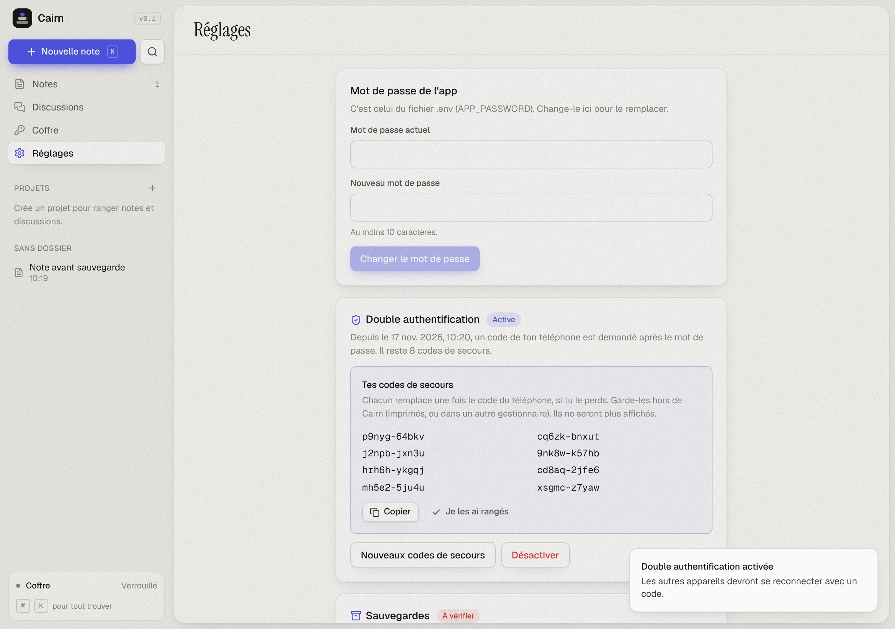
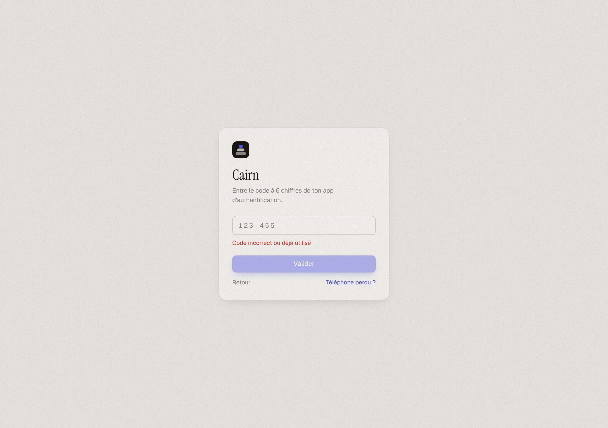

# Sécurité

## Ce qui protège quoi

| Donnée | Protection | Le serveur peut-il la lire ? |
| --- | --- | --- |
| Notes normales, fichiers joints | Mot de passe de l'app, HTTPS | Oui (recherche, API, IA) |
| Notes verrouillées | Chiffrées dans le navigateur avec la clé du coffre | Non (sauf le titre) |
| Coffre : mots de passe, clés SSH | Chiffré dans le navigateur avec la clé du coffre | Non |
| Mot de passe de l'app | Haché avec scrypt dans `data/auth.json` | Seulement le hachage |
| Double authentification | Secret TOTP chiffré (AES-256-GCM) dans `data/two-factor.json`, codes de secours hachés | Oui, il doit vérifier les codes |
| Sauvegardes | Chiffrées avec age, clé privée hors du VPS | Non |
| Mot de passe maître du coffre | Ne quitte jamais l'appareil | Non |

Concrètement : si quelqu'un vole la base ou prend la main sur le VPS **à froid**, il obtient les notes normales, mais ni le coffre ni les notes verrouillées.

## Deux mots de passe, deux rôles

- **Mot de passe de l'app** : ouvre la porte (les notes). Vérifié par le serveur.
- **Mot de passe maître** : ouvre le coffre. Vérifié nulle part : il sert à calculer la clé, sur l'appareil. Il doit être différent du premier, long (une phrase de quelques mots), et **il ne peut pas être récupéré**. Sans lui, le coffre et les notes verrouillées sont perdus.

## Comment le coffre est chiffré

```
mot de passe maître ──Argon2id──► clé de déverrouillage ──AES-256-GCM──► clé du coffre
                                                                            │
                                              AES-256-GCM, un IV aléatoire par bloc
                                                                            ▼
                                                        éléments du coffre, notes verrouillées
```

- **Argon2id** : 64 Mo de mémoire, 3 passes, sel aléatoire de 16 octets. Rend les essais de mots de passe très lents, même avec une copie de la base.
- **Clé du coffre** : 32 octets aléatoires, générés à la création. Elle est stockée sur le serveur, mais chiffrée par la clé de déverrouillage.
- **AES-256-GCM** : chiffre et authentifie. Un bloc modifié est refusé au déchiffrement.
- **Format d'un bloc** : `v1.<IV en base64>.<chiffré en base64>`.
- La clé déverrouillée reste **en mémoire dans l'onglet** : un rechargement, ou 10 minutes sans utilisation, verrouille le coffre. Elle n'est jamais écrite dans le navigateur ni envoyée au serveur.
- Un secret copié est effacé du presse-papiers après 45 secondes (si l'onglet est resté ouvert).

Le code est dans `src/lib/crypto.ts`, avec ses tests (`pnpm test`).

## Double authentification

Réglages > Sécurité > **Activer** : un QR code à scanner avec une app d'authentification (1Password, l'app Mots de passe d'Apple, Authy, Google Authenticator), puis le mot de passe et un premier code pour confirmer. Ensuite, la connexion demande le mot de passe **puis** un code à 6 chiffres.

 Sécurité après l'activation, avec les codes de secours" width="640">


- **TOTP standard** (RFC 6238) : SHA-1, 6 chiffres, 30 secondes. Un pas d'avance ou de retard est accepté (horloge du téléphone un peu décalée). Un code déjà accepté ne repasse pas.
- **8 codes de secours**, affichés une seule fois, chacun utilisable une fois (« Téléphone perdu ? » sur la page de connexion). Le serveur n'en garde que l'empreinte SHA-256. Réglages peut en générer de nouveaux (les anciens cessent de marcher).
- Activer ou désactiver la double authentification **déconnecte les autres appareils** : ils devront repasser par le code. Désactiver demande le mot de passe et un code.
- Le secret est chiffré avec la même clé que les clés d'IA (`CAIRN_SECRET` ou `secret.key`). Si cette clé change, seuls les codes de secours marchent encore.
- **Tout perdu (téléphone et codes de secours)** : sur le VPS, `cd ~/cairn/deploy && docker compose exec cairn rm /data/two-factor.json`. La connexion redevient mot de passe seul. Accéder au VPS par SSH est donc le vrai dernier recours, d'où l'importance de le protéger (voir plus bas).
- `API_TOKEN` n'est pas concerné (scripts, Hermes) : garde-le long et secret.
- Un fichier `two-factor.json` abîmé ne désactive pas la double authentification : personne n'entre jusqu'à ce qu'il soit réparé ou supprimé.

## Compte Postmelo

Avec `COMPTE_URL`, `COMPTE_CLIENT_SECRET` et `APP_URL`, la page de connexion propose **Continuer avec mon Compte Postmelo** : le service de compte de la suite se porte garant de la personne (OpenID Connect, code à usage unique avec PKCE, le secret ne passe jamais par le navigateur).

- **Le mot de passe de Cairn reste valable.** C'est l'entrée de secours si le service de compte est en panne. Pour revenir en arrière, vide les trois variables.
- **Administrateurs seulement.** Cairn n'a qu'un espace : qui entre lit toutes les notes. Un membre du compte est refusé, même si le compte lui ouvre Cairn, sauf avec `COMPTE_MEMBERS=true`.
- **Connexion récente.** Il faut s'être identifié auprès du compte dans les 12 dernières heures, sinon il redemande le mot de passe. Cairn le vérifie aussi de son côté.
- **La double authentification n'est jamais sautée.** Si le compte a la sienne, elle a déjà été passée. Sinon, et si elle est activée ici, Cairn demande son propre code après le retour du compte.
- **Le coffre ne change pas.** Il reste fermé jusqu'au mot de passe maître, que ni Cairn ni le compte ne connaissent.
- Se déconnecter de Cairn ne ferme pas la session du compte.
- Les apps Mac et iPhone gardent le mot de passe de Cairn.

Activer le Compte Postmelo ajoute une porte : la sécurité des notes dépend alors aussi de celle du compte. Active sa double authentification.

## Autour

- Tout est privé sauf la page de connexion. En production, Cairn refuse de démarrer sans mot de passe.
- 8 erreurs (mot de passe ou code, à la connexion comme dans Réglages) bloquent la connexion pendant 15 minutes.
- Changer le mot de passe de l'app déconnecte tous les autres appareils. Réglages > Sécurité > **Déconnecter les autres appareils** fait de même sans changer de mot de passe (téléphone perdu, navigateur resté connecté). Se déconnecter sur un appareil n'efface que son cookie : pour couper un cookie qui aurait été copié, c'est ce bouton.
- Le cookie de session est signé avec une clé aléatoire du serveur (`data/session.key`) : connaître le mot de passe ne suffit pas à en fabriquer un, il faut passer par la connexion (et donc par le code de double authentification). Supprimer `session.key` déconnecte tout le monde.
- Une modification (POST, PUT, PATCH, DELETE) envoyée par une page d'un autre site est refusée, même avec le cookie. C'est utile parce que les autres apps de la suite (`*.postmelo.ch`) sont le « même site » pour le navigateur : `SameSite=Lax` ne suffirait pas.
- Une politique de sécurité du contenu (CSP) limite ce que les pages chargent : scripts et requêtes restent sur Cairn. Si un texte piégé passait un jour le nettoyage du Markdown, il ne pourrait pas envoyer le coffre ouvert ailleurs avec `fetch()`.
- `API_TOKEN` donne accès aux notes et aux fichiers, **jamais** aux routes du coffre ni aux réglages (mot de passe, clés d'IA), qui ne se gèrent que depuis un navigateur connecté.
- Le Markdown est nettoyé avant affichage. Les fichiers joints qui ne sont pas des images, vidéos, sons ou PDF sont toujours téléchargés, jamais affichés : un fichier HTML envoyé ne peut pas exécuter de script sur l'app.
- Cookie de session `HttpOnly`, `SameSite=Lax`, `Secure` en production.

## Ce que l'IA voit

Le bouton « IA » n'envoie quelque chose que lorsque tu choisis une action, et seulement ceci :

| Envoyé au fournisseur d'IA | Jamais envoyé |
| --- | --- |
| Le passage sélectionné, ou la note si rien n'est sélectionné (pour « Continuer » : le texte avant le curseur) | Le coffre |
| Le titre de la note | Les notes chiffrées de bout en bout |
| Ta consigne, pour « Consigne libre » | Les autres notes, les fichiers joints |
| Dans une discussion : ses messages, les consignes de son dossier et de ses parents, les notes épinglées | Une note chiffrée, même épinglée |

- **Discussions** : elles sont enregistrées dans la base comme les notes normales (lisibles par le serveur, qui doit bien les envoyer au fournisseur). Les notes épinglées sont lues par le serveur dans la base : d'une note chiffrée, il n'a qu'un bloc illisible, qu'il laisse de côté. Son texte déchiffré n'existe jamais côté serveur.
- **Notes chiffrées** : l'IA y est désactivée, même quand la note est déverrouillée à l'écran. S'en servir enverrait le texte déchiffré au serveur, puis au fournisseur. Le blocage est fait dans le code qui envoie la demande, pas seulement dans le menu.
- **Où part le texte** : avec Hermes, il va de Cairn à Hermes sans quitter le VPS, puis Hermes l'envoie au modèle que tu lui as configuré. Avec Anthropic ou OpenAI, il part chez eux, sous leurs conditions d'API. Sans fournisseur configuré, rien ne part nulle part.
- **Les clés d'API** sont dans le `.env` du serveur ou saisies dans Réglages > IA. Celles de Réglages sont chiffrées dans la base (AES-256-GCM) avec une clé du serveur : `CAIRN_SECRET` si tu le définis, sinon `data/secret.key`, créé au premier usage et lisible par l'app seule. La sauvegarde nocturne emporte `secret.key`, mais dans une archive chiffrée avec age : une restauration ramène les clés d'IA, une sauvegarde volée ne livre rien. Si tu utilises `CAIRN_SECRET`, garde-le avec le `.env`, hors du VPS. Le navigateur ne reçoit jamais une clé, seulement ses 4 derniers caractères pour la reconnaître, et elles sont retirées des messages d'erreur, comme les identifiants qu'une adresse pourrait contenir (`utilisateur:motdepasse@`).
- **Une note ne commande pas l'IA** : son contenu et son titre sont présentés au modèle comme un texte à travailler, pas comme des instructions, entre des balises au nom tiré au hasard à chaque demande (un texte collé qui contient `</note>` ne referme rien). C'est une défense en profondeur, pas une garantie : un modèle peut quand même se laisser influencer. Relis ce que l'IA propose avant de l'insérer. Rien n'est écrit dans la note sans ton clic. Avec Hermes, la vraie limite est celle des outils que tu as donnés à l'agent.
- **La réponse ne charge rien d'un autre site** : dans le panneau et dans les discussions, elle est affichée sans image, vidéo ni style distants (ils deviennent des liens à cliquer). Sinon, un texte piégé pourrait faire écrire à l'IA une adresse d'image qui emporte un bout de la note vers un tiers, avant même ton clic. Une fois insérée dans la note, la réponse est du Markdown comme le reste : l'aperçu affiche alors ses images.
- `API_TOKEN` donne aussi accès à `/api/ai`, `/api/folders` et `/api/conversations` : un script qui a le jeton peut lire tes discussions et utiliser ton IA (et donc ta clé ou ton Hermes).

## Limites à connaître

Mieux vaut les avoir en tête que les découvrir :

1. **Le code vient du serveur.** Comme tout gestionnaire de mots de passe web, le chiffrement est fait par du JavaScript servi par le VPS. Quelqu'un qui contrôle le VPS **pendant que tu l'utilises** pourrait servir une page modifiée qui capte le mot de passe maître. Les apps natives prévues (Tauri, iOS) retirent cette limite : leur code ne vient pas du serveur.
2. **Les notes normales ne sont pas chiffrées dans la base.** C'est le choix fait pour garder la recherche et l'IA simples. Et ce que tu confies au bouton « IA » sort du VPS si le fournisseur est Anthropic ou OpenAI. Utilise le cadenas pour ce qui est sensible, et active le chiffrement du disque du VPS si ton hébergeur le propose.
3. **Le titre d'une note verrouillée reste lisible**, ainsi que les fichiers joints à cette note.
4. **Un seul utilisateur.** Pas de comptes, pas de partage.
5. **Pas encore de passkeys.** La double authentification est un code TOTP, pas une clé physique : elle protège d'un mot de passe volé, pas d'une page d'hameçonnage qui relaierait le code en direct.
6. **Pas d'audit externe.** Le chiffrement s'appuie sur des briques standard, mais l'ensemble n'a été relu par personne d'autre. Garde une copie de tes clés SSH ailleurs tant que Cairn est jeune.

## Le coffre dans les apps Mac et iPhone

Les apps ouvrent le coffre comme le navigateur, sur l'appareil, avec le même calcul (Argon2id par libsodium, puis AES-GCM) : le serveur ne voit toujours rien.

- **Mot de passe maître** : la clé est calculée sur l'appareil et reste en mémoire. Le coffre se verrouille après 10 minutes sans usage, et dès que l'app passe en arrière-plan.
- **Face ID / Touch ID** (en option, dans le menu du coffre) : la clé du coffre est rangée dans le Trousseau, réservée à cet appareil, et ne s'ouvre qu'après Face ID ou Touch ID. Si les visages ou empreintes enregistrés changent, le système l'efface et il faut retaper le mot de passe maître.
- **Remplissage automatique** : l'app laisse une copie du coffre, toujours chiffrée, dans un dossier partagé avec l'extension. L'extension l'ouvre avec Face ID ou le mot de passe maître, sans réseau. La liste des suggestions au-dessus du clavier ne contient que les domaines et identifiants, jamais les mots de passe.
- **Presse-papiers** : un mot de passe copié depuis l'app s'efface après 90 secondes, et sur iPhone il ne passe pas aux autres appareils.
- **Hors ligne** : les notes sont copiées dans le conteneur de l'app (sur iPhone, fichier chiffré par le système tant que le téléphone n'a pas été déverrouillé depuis le démarrage). Les notes à cadenas et les modifications en attente qui les concernent restent chiffrées.
- **Se déconnecter** efface tout de l'appareil : clé, copie des notes et du coffre, suggestions.

## Importer et exporter le coffre

- **Import** (1Password, Bitwarden, NordPass, navigateurs) : le fichier est lu dans le navigateur, chaque élément est chiffré avec la clé du coffre, puis envoyé. Le serveur refuse tout élément qui n'est pas chiffré. Un export Bitwarden « chiffré » n'est pas lisible : il faut l'export `.json` simple. **Supprime le fichier d'export après l'import** (et vide la corbeille) : il contient tout en clair.
- **Export chiffré** : les éléments tels que le serveur les stocke, avec les paramètres de dérivation. Il s'ouvre avec le mot de passe maître du moment de l'export, et se réimporte dans Cairn (les doublons sont ignorés). C'est une bonne copie à garder hors du VPS.
- **Export en clair** (CSV ou JSON) : demande de retaper le mot de passe maître, même coffre ouvert. À n'utiliser que pour passer à un autre gestionnaire, et à supprimer aussitôt.

## Bonnes pratiques sur le VPS

- SSH par clé uniquement, pare-feu (80, 443 et SSH), mises à jour automatiques, fail2ban.
- Sauvegardes chiffrées chaque nuit, copiées hors du VPS (voir [DEPLOIEMENT.md](DEPLOIEMENT.md), étape 5). La clé privée age reste sur ton Mac, pas seulement dans Cairn.
- Teste une restauration (`restore.sh --check`) une fois par trimestre.
