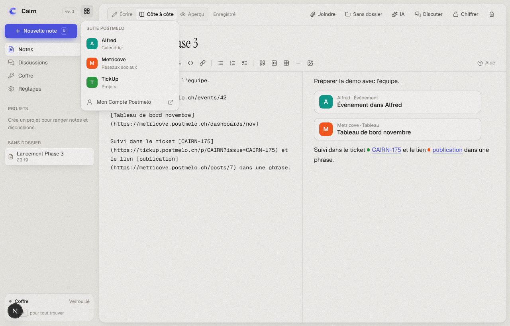
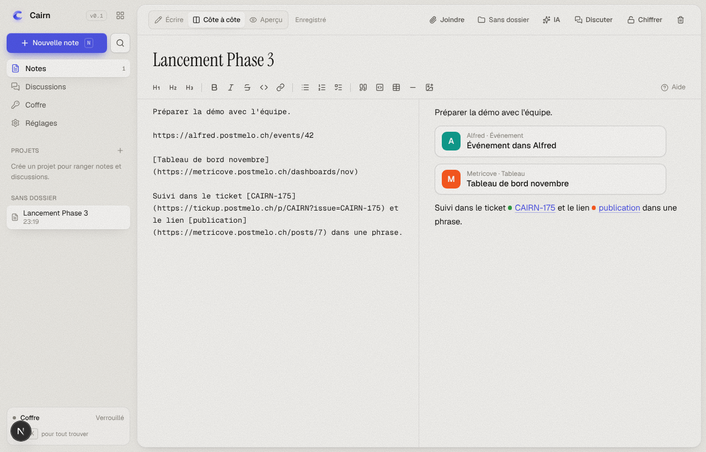
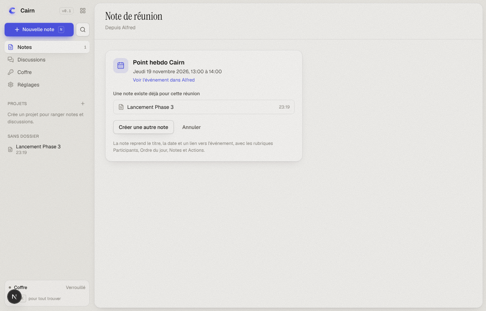

# Cairn dans la suite PostMelo

Cairn, Alfred, Metricove et TickUp forment la suite PostMelo. La **connexion unique** est assurée par le [Compte Postmelo](SECURITE.md#compte-postmelo) : rien ne change de ce côté. Ce document décrit ce que Cairn ajoute par-dessus : un menu pour passer d'une app à l'autre, des cartes pour les liens entre apps, et la « Note de réunion ».

## Le menu des apps



Le bouton en grille, à côté du logo (en haut à droite sur téléphone), liste les autres apps de la suite et le Compte Postmelo. Comme on est déjà connecté au compte, ouvrir Alfred depuis Cairn ne redemande pas de mot de passe.

La liste vient de `SUITE_APPS` (voir le README). Par défaut : Alfred, Metricove et TickUp sur `*.postmelo.ch`. Le lien « Mon Compte Postmelo » n'apparaît que si `COMPTE_URL` est réglé.

## Les liens entre apps



Un lien vers une app de la suite, **seul sur sa ligne**, s'affiche comme une carte : l'app, le genre de page (Événement, Publication, Tableau, Ticket CAIRN-175…) et le titre du lien. Une adresse collée telle quelle devient « Événement dans Alfred ». Dans une phrase, le lien garde son aspect et prend juste la pastille de couleur de l'app.

Le genre de page est deviné à partir de l'adresse, sans rien demander à l'autre app : aucune donnée ne sort de Cairn pour afficher une carte. Les liens s'ouvrent dans un nouvel onglet.

## La note de réunion



Une autre app (Alfred) ouvre cette adresse, par exemple derrière un bouton « Note de réunion » sur un événement :

```
https://cairn.postmelo.ch/notes/reunion?titre=Point%20hebdo&date=2026-11-19T14:00:00%2B01:00&fin=2026-11-19T15:00:00%2B01:00&lien=https%3A%2F%2Falfred.postmelo.ch%2Fevents%2F42
```

| Paramètre | Contenu |
| --- | --- |
| `titre` | Le titre de l'événement (200 caractères au plus). « Réunion » s'il manque. |
| `date`, `fin` | Début et fin, de préférence en ISO 8601 avec le fuseau. Un texte libre est repris tel quel. |
| `lien` | L'adresse de l'événement. Gardée seulement si elle mène à une app de la suite. |

Cairn affiche la réunion et les notes qui renvoient déjà vers cet événement, puis crée la note seulement quand on appuie sur **Créer la note** (n'importe quel site pourrait ouvrir cette adresse). La note commence par le lien vers l'événement, qui s'affiche en carte, puis la date et les rubriques Participants, Ordre du jour, Notes et Actions.

Pas encore connecté ? Cairn passe par la connexion (mot de passe ou Compte Postmelo) puis revient sur la page de la réunion, pendant 10 minutes. Seule cette page peut servir de retour.

## Les notes liées, vues depuis une autre app

```
GET https://cairn.postmelo.ch/api/links?url=https%3A%2F%2Falfred.postmelo.ch%2Fevents%2F42
Authorization: Bearer <SUITE_TOKEN>
```

```json
{ "notes": [{ "id": "J9Nk-DqyLtr3", "title": "Point hebdo", "updatedAt": "2026-11-19T13:02:11.000Z", "url": "https://cairn.postmelo.ch/notes/J9Nk-DqyLtr3" }] }
```

Les titres et les adresses seulement, jamais le contenu. Les notes à cadenas n'y sont jamais (le serveur ne peut pas les lire). `SUITE_TOKEN` n'ouvre que cette route, en lecture : il ne donne accès ni aux notes, ni au coffre, ni aux réglages. L'app qui l'utilise le garde côté serveur, jamais dans le navigateur.

## Ce qui reste à faire côté Alfred

1. Un bouton « Note de réunion » sur un événement, qui ouvre l'adresse ci-dessus.
2. Une rubrique « Notes liées » sur un événement, remplie par `GET /api/links` avec `SUITE_TOKEN` (le même secret des deux côtés).
3. Optionnel : le même menu des apps, pour revenir vers Cairn.
